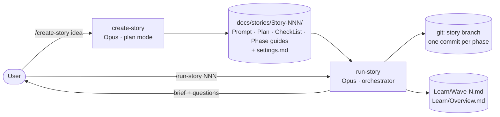
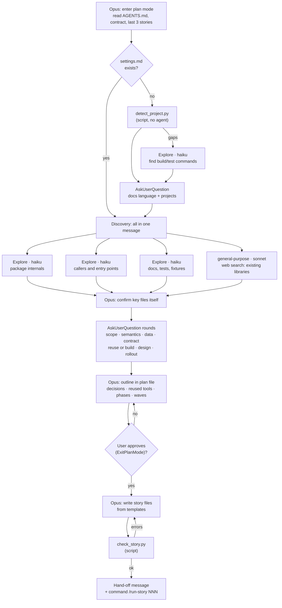
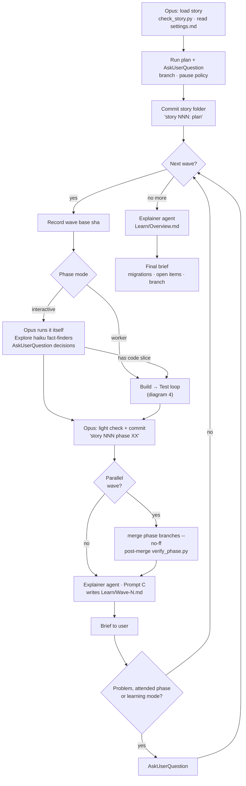
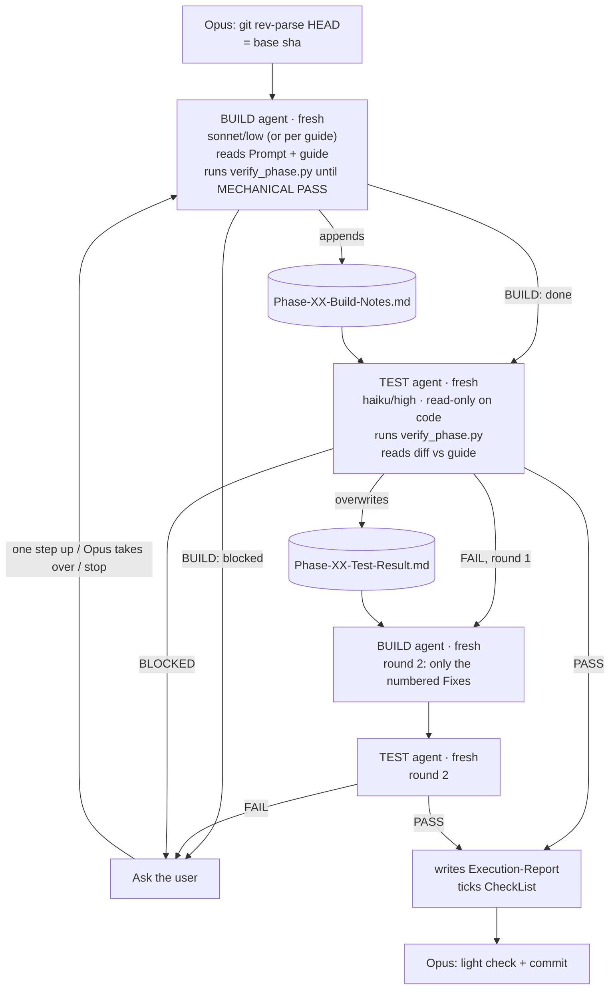
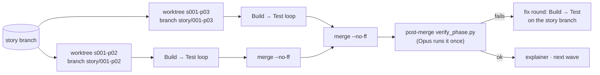

# Flow of the story skills

Two skills: `create-story` plans, `run-story` executes. Colors: Opus = orchestrator, Sonnet = builder, Haiku = tester and fact-finder.

## 1. Big picture

The user starts both skills. They share only files in `docs/stories/` and git, so a chat can be cleared between them.

## 2. create-story: who does what

Discovery runs in parallel with cheap agents. Every design choice goes to the user. Nothing is written before the outline is approved.

## 3. run-story: the whole run

Each wave holds phases that may run in parallel. After each wave an explainer writes the study note. The user is asked only on problems, attended phases, or when learning mode is on.

## 4. The build → test loop (one worker phase)

Every agent is fresh. State moves only through files and git, so no agent carries a long context.

## 5. Parallel wave with worktrees

Used only when every project builds from the worktree's own files. Otherwise phases run one after another in the main tree.

## Agent roster

| Agent | Model | Started by | Count | Reads | Writes |
|---|---|---|---|---|---|
| Orchestrator | Opus | user | 1 per run | story folder, statuses only | commits, briefs |
| Explore (facts) | haiku | either skill | up to 3 per discovery, more in interactive phases | repo | nothing (report in reply) |
| Library search | sonnet | create-story | 1 | web, manifests | nothing |
| Build | per guide (sonnet/low default) | run-story | 1 per round, max 2 before asking | Prompt, guide, Test-Result | code, tests, Build-Notes |
| Test | per guide (haiku/high default) | run-story | 1 per round | diff, guide, Build-Notes | Test-Result, report, CheckList |
| Explainer | per Prompt C | run-story | 1 per wave + 1 Overview | wave diff, guides | Learn/Wave-N.md |

No agent starts another agent. Only the orchestrator spawns, so nesting depth is 1.
