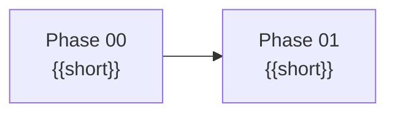

# Plan — Story {{NNN}}: {{Title}}

## Target shape

{{Optional, large stories. A Mermaid diagram of modules and the contracts between them, then 2–4 bullets.}}

## Phase order

1. [Phase 00 — {{Title}}](Phase-00-{{Title-In-Kebab-Case}}.md)
2. [Phase 01 — {{Title}}](Phase-01-{{Title-In-Kebab-Case}}.md)

| Wave | Phases | Start when |
|---|---|---|
| 1 | 00 | Now |
| 2 | 01 | Phase 00 is merged |

Start each phase in a fresh session from a clean tree:

> Read `docs/Ai/Prompts/{{Story-NNN-Folder}}/Prompt.md` and run Phase NN.

{{If a wave has several phases: "Parallel phases touch the same shared spots: <files>. Only append your own lines there; on a conflict, keep both sides."}}

## {{Shared recipe: <name>}}

1. {{Steps every phase of this kind follows, with the existing code to copy.}}

## Guardrails

- {{Rules that apply across phases.}}

## Stop conditions

Stop and ask the maintainer if:

- {{situations where the worker must not guess}}
