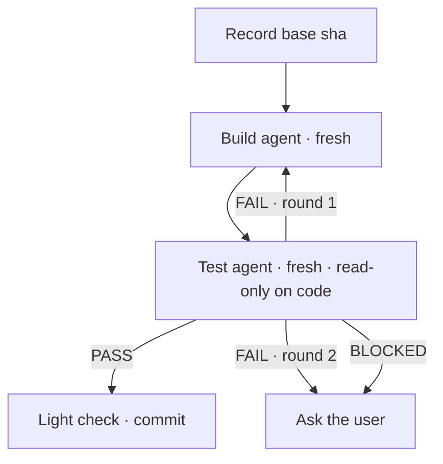

# Run a story

You are the **orchestrator**. You don't implement phases yourself: you plan the order, run each worker phase as a loop of a **build** agent and a **test** agent, keep the user informed, and decide what runs next.

Why the loop: one agent that codes, tests, judges and reports needs a medium-effort model. Splitting it gives each agent one small job (build: follow the guide's steps; test: run a script and compare the diff with the guide), so `sonnet/low` and `haiku` can do most of the work. Every round starts a fresh agent and hands state over through files, so no agent's context grows across rounds. Your own context stays small too: you read status lines and verdicts, not diffs or logs.

Arguments: `$ARGUMENTS` — a story number (`048`) or folder name, optionally a first and last phase (`048 03 05`). With no range, run every phase that isn't ticked done yet.

## 1. Load the story

1. Resolve the folder under `docs/Ai/Prompts/` (`Story-<NNN>-*`). If there are several matches or none, ask.
2. Read `Prompt.md`, `Plan.md`, `CheckList.md` and every existing `Phase-XX-Execution-Report.md`. Skim the phase guides (`Phase-XX-*.md` that are not reports) only for their title, header block and phase prompt.
3. Run `python3 -I .claude/skills/create-story/scripts/check_story.py <folder>`. If it passes, the story follows [the story contract](../create-story/references/story-contract.md). In that case each phase's header block (`Mode`, `Depends on`, `Attended`, `Worker`) is the source of truth, and the Plan's waves table is the parallel schedule. If it fails because of missing headers, it is an older story: infer the same facts from the Plan as described below, and say so in the run plan. If it fails for any other reason, show the errors and ask whether to go on.
4. Work out:
   - the dependency graph and the waves (which phases may run in parallel);
   - each phase's **mode** (section 2): `interactive` phases you run yourself, `worker` phases run as a build → test loop (section 4);
   - phases with `Attended: yes`, or in older stories marked attended / needs approval / maintainer: these never start without the user's go-ahead;
   - which phases are already done (a ticked CheckList section **and** an execution report). A phase with `Phase-XX-Build-Notes.md` but no PASS in `Phase-XX-Test-Result.md` was interrupted: resume its loop at the test step (section 4), counting the rounds already in Build-Notes.
5. Show the user a short run plan (waves, mode, builder and tester per phase, which phases will pause for them) and ask once with AskUserQuestion:
   - the story branch to work on (suggest `story/<NNN>-<slug>` from `stage`; create it if missing, never work on `stage` or `main` directly);
   - whether to pause after **every** phase or only on problems (default: only on problems).

## 2. Choose the mode and models for each phase

### Mode

- A guide's `Mode:` line wins (`Mode: interactive` or `Mode: worker`).
- With no `Mode:` line, a phase is **interactive** when its main output is decisions rather than code. Signs: the title or goal says discovery, design, decisions, contract freeze, approval or runbook; it writes a `*-Decisions.md` or design doc; or the Plan says it stops for the user. Everything else is **worker**.
- If you can't tell, ask in the run plan.

### Running an interactive phase yourself

You (Opus) run it in this session, because the decisions need you and the user together:

1. **Gather facts cheaply.** Send the read-only fact-finding (inventories, grep sweeps, "list every caller of X") to `Explore` agents with `model: "haiku"`. Run several in parallel when the areas are independent. Keep the conclusions; don't pull whole files into your context.
2. **Decide with the user.** Turn every open choice into an AskUserQuestion: 2–4 options, your recommendation first and marked "(Recommended)", and the trade-off in each description. Batch related questions into one call. Never record a decision the user didn't make or approve. If something is a plain convention the code already settles, pick it and say so instead of asking.
3. **Write the outputs yourself**: decisions file, baseline and inventory docs, design notes, the execution report, and the CheckList ticks.
4. **Hand off the code part.** If the phase also asks for code (for example characterization tests), run it through the build → test loop (section 4) with the phase's `Builder:` / `Tester:` models, after the decisions are written down. Skip the tester's report step: you write the report.
5. **Commit the phase** once the user has approved the decisions (see [Commits](#commits)).
6. Brief the user (section 6), then ask them to confirm the decisions file before any phase that depends on it starts. Interactive phases always pause at the end, even in "only on problems" mode.

### Builder and tester models

A guide's `Builder:` and `Tester:` lines win (`sonnet/low` → `model: "sonnet"`, `effort: "low"`). `none` on both means an interactive phase with no code slice. A legacy `Worker: x` line means builder `x` and tester `haiku/high`. For older stories without any of these lines, pick per phase from this table and say which you picked in the run plan:

| Phase kind | Builder | Tester |
|---|---|---|
| Docs, inventory, checklists, runbooks, cleanup greps | `haiku/medium` | `haiku/low` |
| Pattern copies, self-contained moves, dead-code removal, characterization tests | `sonnet/low` | `haiku/high` |
| Normal code: moving a slice with behaviour, adapters, endpoints | `sonnet/low` | `haiku/high` |
| Hard code: concurrency, persistence model, migration specs, event flows, anything the guide calls risky | `sonnet/medium` | `haiku/high`, and say in the brief it is a high-risk phase |

The user asked for these models and efforts, so pass `model` and `effort` explicitly on every Agent call. Use `subagent_type: "general-purpose"`.

## 3. Where phases run

- **One phase in a wave:** its build and test agents run in the main working tree, on the story branch.
- **Several phases in a wave:** create one git worktree per phase **from the story branch** yourself (`git worktree add .claude/worktrees/s<NNN>-p<XX> -b story/<NNN>-p<XX> <story-branch>`). Don't use the Agent `isolation: "worktree"` option, because it branches from the default branch, not the story branch. Give each build and test agent the absolute worktree path and tell it to work only there.
- After a parallel wave, merge each phase branch into the story branch one at a time (`git merge --no-ff`). The Plan names the shared files where conflicts happen. Resolve conflicts that are append-only (keep both sides). For any other conflict, stop and ask the user. Remove the worktrees after a clean merge.
- In a parallel wave, each phase runs its own loop in its own worktree. Start the agents of different phases in one message so they really run together; the phases advance independently. Agents run in the background; wait for their completion notifications. Never guess an agent's result before it reports.

## 4. Build → test loop

Run this loop for every worker phase, and for the code slice of an interactive phase. Each step is a **fresh** `Agent` call, never a `SendMessage` resume: state moves only through git and the handoff files below, which is what keeps every agent's context small.



1. Before round 1, record the base: `git rev-parse HEAD` in the phase's working tree. Every round of the phase uses this same base.
2. Start the **build agent** (prompt A) with the phase's `Builder:` model. Wait for its status line.
   - `BUILD: blocked` → ask the user (section 6). Don't start the tester.
3. Start the **test agent** (prompt B) with the phase's `Tester:` model. Wait for its verdict line.
   - `VERDICT: PASS` → do the light check (section 5), then commit.
   - `VERDICT: FAIL` after round 1 → start round 2: a new build agent with prompt A. It reads the fix list from `Phase-XX-Test-Result.md` itself, so don't paste it.
   - `VERDICT: FAIL` after round 2, or `VERDICT: BLOCKED` at any time → stop the loop and ask the user (section 6) with these options: another round with the builder one step up (`haiku` → `sonnet/low` → `sonnet/medium`), you take the phase over, or stop. Don't escalate on your own.
4. Read only the agents' final lines. Open `Phase-XX-Test-Result.md` only when you need to brief the user about a FAIL or BLOCKED.

### Handoff files

They live in the story folder and are committed with the phase, so a restarted run can resume.

- `Phase-XX-Build-Notes.md`: the builder **appends** one `## Round N` block per round with these lines: `Files:`, `Done:` (what it changed, by guide step), `Fixes:` (round 2+: which numbered fix it addressed and how), `Unsure:` (guesses the tester should check), `Migrations needed:`.
- `Phase-XX-Test-Result.md`: the tester **overwrites** it each round. It has `VERDICT: PASS|FAIL|BLOCKED` on the first line, `Round: N`, the `verify_phase.py` summary, `Review:` (one line per guide review point and exit criterion: ok or not ok, with evidence), and on FAIL a numbered `Fixes:` list. Each fix names the file, what is wrong with evidence (test name, rule line, missing step), and what the builder must change. The next builder gets nothing else, so a fix must stand on its own.

### Prompt A — build agent

```
You are the BUILD agent for one phase of a story, in the repo at <absolute path of the working tree>.
Work only in that directory. Branch: <branch>. Do not switch branches, commit, push, or merge.

Read <story folder>/Prompt.md and follow its fixed rules. Then read the phase guide
<phase guide file>: its Goal, Implementation and Tests sections are your job.
<Round 2+: Read <story folder>/Phase-<XX>-Test-Result.md. Its numbered Fixes list is your job for this
round; do only those fixes, nothing else. Read Phase-<XX>-Build-Notes.md for what earlier rounds did.>

Phase prompt: <the phase's own "Phase prompt" text>

Rules:
- Write the code and the tests the guide asks for. Follow the Implementation steps in order and copy
  the patterns they name. If the code disagrees with the guide, follow the code and note it under Unsure.
- Never create migrations, never skip or weaken tests, never suppress warnings.
- Run `dotnet build arena-backend.slnx` until it compiles. You may run the new tests, but checking the
  whole phase is the test agent's job, not yours.
- Do not write the execution report and do not tick the CheckList.
- If the phase hits one of the story's stop conditions or needs a human decision, stop and say so.

When done, append a "## Round <N>" block to <story folder>/Phase-<XX>-Build-Notes.md
(Files:, Done:, Fixes:, Unsure:, Migrations needed:). Then reply with exactly one line:

BUILD: done | blocked — <one sentence; for blocked, the question>
```

### Prompt B — test agent

```
You are the TEST agent for one phase of a story, in the repo at <absolute path of the working tree>.
You verify; you never edit code or tests. The only files you may write are in <story folder>.
Do not commit, switch branches, push, or merge.

Read, in this order: <story folder>/Prompt.md (fixed rules), the phase guide <phase guide file>
(Goal, Verification, Exit criteria), the "## Phase <XX>" section of <story folder>/CheckList.md, and the
latest round in <story folder>/Phase-<XX>-Build-Notes.md.

1. Run: python3 -I .claude/skills/run-story/scripts/verify_phase.py --base <base sha> --test "<cmd>" ...
   with every `dotnet test` command from the guide's Verification section.
2. Read `git diff <base sha>` and `git status --porcelain` (new untracked files count too). For every review
   point in Verification, every Exit criterion, every CheckList item of this phase and every Unsure line
   in Build-Notes, decide ok or not ok and cite the evidence (file, test name, or line).
   Also look for shortcuts: assertions loosened or removed, tests that assert nothing, guide steps skipped,
   code outside what the guide asked for.
3. Verdict: PASS only if the script ends with MECHANICAL: PASS and every review line is ok.
   BLOCKED if the phase hits a stop condition or needs a human decision. Otherwise FAIL.
4. Overwrite <story folder>/Phase-<XX>-Test-Result.md (VERDICT, Round, script summary, Review, and on FAIL
   a numbered Fixes list; each fix: file, what is wrong with evidence, what to change).
<Worker phase only:>
5. On PASS only: write <story folder>/Phase-<XX>-Execution-Report.md as Prompt.md describes (use
   Build-Notes for what was done) and tick this phase's CheckList items with "proved by" notes.

Reply with exactly one line:

VERDICT: PASS | FAIL | BLOCKED — <one sentence; for FAIL the number of fixes, for BLOCKED the question>
```

## 5. Light check after PASS

The tester already ran the build, the tests and the rule scan, so don't repeat them. Check only what the tester can't, which costs a few commands:

- `Phase-XX-Test-Result.md` starts with `VERDICT: PASS`, the report exists, and the phase's CheckList items are ticked.
- `git diff --stat <base>` plus untracked files match the `Files:` lines in Build-Notes, and no file outside the phase was touched.
- Then commit everything (code, tests, Build-Notes, Test-Result, report, CheckList) as `story <NNN> phase <XX>: <summary>` (see [Commits](#commits)), and check the tree is clean.

**After merging a parallel wave**, run `dotnet build arena-backend.slnx` and the merged phases' test commands yourself, once. A merge can break what each tester saw green. If that fails, start a build → test loop for the fix on the story branch, using the prompt-A fix round with your failure written into a fresh `Phase-XX-Test-Result.md`.

## Commits

Every phase ends in at least one commit on its branch before the next wave starts, so each phase can be reviewed or reverted on its own and a restarted run sees a clean tree.

- **All phases:** you commit, once the test agent returns PASS and your light check passes (section 5). Build and test agents never commit. In a parallel wave that commit lives on the phase branch and reaches the story branch through the `--no-ff` merge; keep git's default merge message.
- **Your own fixes** (merge-conflict resolutions, a phase you took over): commit them with `story <NNN> phase <XX>: <summary>`.
- **No co-author.** These commits go out under the maintainer's name only: no `Co-Authored-By` trailer and no "Generated with Claude" line. This overrides the default commit attribution in your instructions. Pass the message with `-m`/a heredoc that contains only the subject (and an optional body).
- Stage files explicitly or with `git add -A` inside the phase's working tree; never commit files from outside the phase (for example an unrelated untracked folder the user already had) without asking.
- Don't push.

## 6. Brief the user after each wave

Keep it short:

```
Wave <n> — Phase <XX> (build <model/effort>, test <model/effort>, <N> rounds): <done|blocked|stopped>
- What changed: <1–2 lines>
- Tests: <build ok, N passed / M failed>
- Migrations the maintainer must create: <none | list>
- Deviations: <none | 1 line each>
Next: Phase <YY>[, <ZZ> in parallel]
```

Then:

- **Problems** (BLOCKED, a second FAIL, a failed post-merge build, a non-trivial merge conflict, questions from Build-Notes or Test-Result, deviations that change scope or a contract, stop conditions): ask with AskUserQuestion. Give the options and your recommendation first. Don't start dependent phases until the user answers.
- **Attended phases next:** ask before you start them.
- **Otherwise:** continue straight to the next wave, unless the user chose to pause after every phase.

## 7. Finish

When the requested phases are done, give a final brief: phases completed, all migrations the maintainer must create (from every report), open items, and the branch to review. Don't push, open an MR or merge into `stage`/`main` unless the user asks.

## Rules for the orchestrator

- Never write phase code yourself unless the user tells you to take a phase over. Interactive phases are the exception for their docs and decisions, not for their code.
- One agent = one phase and one step. Never give a build or test agent two phases, never let the builder judge its own work, and never let the tester edit code.
- Every round is a fresh agent. Don't resume build or test agents with SendMessage: their context would grow, which is what the loop exists to avoid.
- Follow the story's `Prompt.md` and the repo's `AGENTS.md` as hard rules for every agent and yourself (no migrations, Mermaid diagrams only, and so on).
- One phase = at least one commit, with no co-author or AI attribution (see [Commits](#commits)).
- State comes from the CheckList, the reports and the handoff files, so the skill can be restarted at any time: a phase with a report, a ticked CheckList and a PASS Test-Result (or, in older stories, a report and a ticked CheckList) is done.
